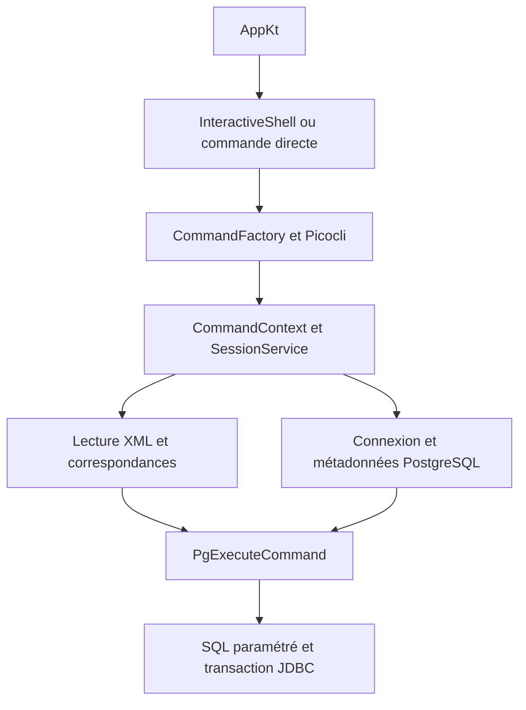

# Architecture et développement

tcHaoFSQL est une application Kotlin JVM organisée en modules Gradle. Sans argument, le point d'entrée ouvre une session interactive. Avec des arguments, il exécute une commande puis termine avec son code de retour.

[Accueil](../README.md) · [Commandes](commandes.md) · [Règles d'import](import.md)

## Organisation du dépôt

| Chemin | Responsabilité |
| --- | --- |
| `app/src/main/kotlin/App.kt` | Point d'entrée `net.unotec.app.AppKt` |
| `app/src/main/kotlin/commands/` | Commandes Picocli, terminal JLine et orchestration |
| `app/src/main/kotlin/services/` | Lecture XML, connexion, correspondances et SQL |
| `app/src/main/kotlin/interfaces/` | Contrats des services |
| `app/src/main/kotlin/models/` | Configuration, métadonnées et état de session |
| `app/src/test/` | Tests et XML d'exemple |
| `utils/` | Module utilitaire, dépendance de `app` |
| `buildSrc/` | Convention Kotlin JVM partagée, toolchain Java 26 |
| `gradle/libs.versions.toml` | Catalogue des versions partagées |
| `.github/workflows/` | CI et publication des releases |

Le module `utils` contient actuellement un utilitaire `Printer` ; il ne participe pas au parcours d'import de `App.kt`.

## Parcours d'une commande



`CommandFactory` construit l'arbre des commandes et conserve un `CommandContext` commun aux invocations. `SessionService` stocke notamment la configuration, le chemin XML et les correspondances. `CommandContext.data` conserve les colonnes, les lignes XML, la clé et les valeurs explicites. Ils utilisent tous deux le modèle `SessionData`, mais pas la même instance.

`resetMappings()` efface les correspondances, les lignes transformées et la clé. `clear()` remet également la configuration et les données chargées à zéro. Les commandes invalident cet état lorsque leurs entrées changent ; voir la [référence](commandes.md).

## Services et adaptations JDBC

| Composant | Responsabilité |
| --- | --- |
| `FileLoaderService` | Vérifier le chemin et ouvrir le fichier |
| `XmlReaderService` | Extraire colonnes et lignes par StAX |
| `DatabaseService` | Vérifier la configuration et ouvrir une connexion JDBC |
| `PostgreReaderService` | Lire les métadonnées des colonnes |
| `MapperService` | Associer les colonnes et préparer les valeurs |
| `SqlWriterService` | Construire l'UPSERT et lier ses paramètres |
| `PostgreWriterService` | Exécuter une requête préparée |
| `PgExecuteCommand` | Coordonner les lignes et la transaction globale |

Les adaptateurs de `commands/pg/jdbc/JdbcAdapters.kt` interviennent à la frontière des services. `metadataConnection` traduit la lecture `SIZE` en `COLUMN_SIZE` dans les métadonnées JDBC. Pendant l'import, un proxy diffère les appels `commit` et `rollback` du service d'écriture pour laisser `PgExecuteCommand` décider du sort de la transaction entière. Une modification de ces services demande donc de vérifier leurs adaptateurs et l'orchestration.

## Compiler et vérifier

Avec un JDK 26 et `JAVA_HOME` configuré, depuis PowerShell à la racine du dépôt :

```powershell
.\gradlew.bat :app:test # Tester le module applicatif
.\gradlew.bat check # Vérifier tous les modules
.\gradlew.bat :app:installDist # Préparer une distribution locale décompressée
.\app\build\install\app\bin\app.bat --help # Vérifier le lanceur local
.\gradlew.bat :app:distZip # Produire app/build/distributions/app.zip
```

Les tests utilisent JUnit Platform et MockK. Ils couvrent notamment la lecture XML, les correspondances, le SQL et les services PostgreSQL simulés. `CommandsTest` vérifie la persistance de l'état entre commandes, la configuration partielle et les décisions de transaction avec erreurs simulées. Ces tests ne remplacent pas une validation sur un serveur PostgreSQL réel.

Pour une modification de commande ou d'import, lance le test concerné, puis réalise un essai `--rollback` sur une base de démonstration. Mets à jour la référence si la syntaxe ou les effets sur la session changent.

## CI et releases

Le workflow [ci.yml](../.github/workflows/ci.yml) s'exécute sur les pushes et les pull requests. Il utilise Java 26, exécute les tests applicatifs et produit une distribution ZIP comme artefact de workflow.

Le workflow [realease.yml](../.github/workflows/realease.yml) se déclenche sur le push d'un tag commençant par `v`. Il exécute `:app:test :app:distZip`, puis crée une release GitHub avec le ZIP et des notes générées. Son jeton dispose du droit `contents: write`. Publier un tag correspondant déclenche donc la publication de la release.

La distribution contient les scripts sous `bin` et les dépendances sous `lib`. Le JDK et les ressources de test, dont `data.xml`, ne sont pas inclus dans le ZIP.
